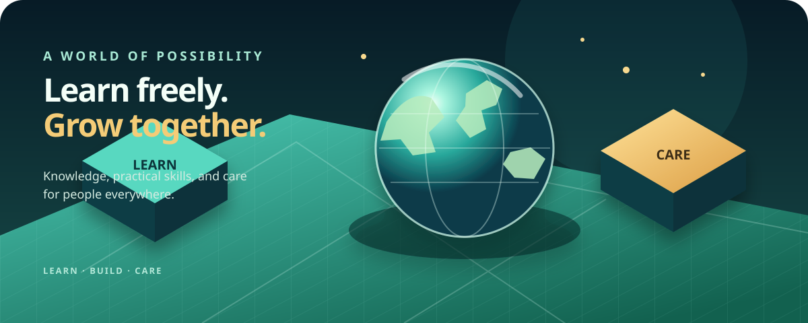

# 🌍 Humanity World — Learn, grow, and help each other

> **A more humane world starts with shared knowledge.**

<div align="center">
  
  <br />
  <strong>Learn freely · Build practical skills · Care for one another</strong>
</div>

Humanity World is a small, installable learning platform for people everywhere. Ask a study question, get a clear answer in one of 40 supported answer languages, and take a practical next step. It is designed to work on phones and computers, with an offline app shell and a server-side AI connection.

> **Deployment status:** This repository does not yet have a live Vercel deployment. Use the deploy button below to create one; after deployment, replace the example address with your actual Vercel URL.

[](https://vercel.com/new/clone?repository-url=https%3A%2F%2Fgithub.com%2Fnirajmallik143-hub%2Fhumanity-Nepal-AI-)

**Repository:** [github.com/nirajmallik143-hub/humanity-Nepal-AI-](https://github.com/nirajmallik143-hub/humanity-Nepal-AI-) · **Deployment URL:** `https://YOUR-PROJECT.vercel.app` (replace after deployment)

## What it offers

- **A copy-and-paste group access flow:** the site owner shares a Mallik Group access code; visitors paste it into the access dialog. No Firebase, email accounts, or passwords are required.
- **A multilingual AI learning guide:** 40 answer languages, including English, Nepali, Hindi, Arabic, Chinese, Spanish, and French.
- **A private provider integration:** Gemini or OpenAI is called only from the Python server. Provider keys are never placed in the page or returned by the API.
- **A mobile-friendly PWA:** install support, a cached offline shell, and reduced-motion-aware 3D-inspired styling.
- **A human-centered learning approach:** clear explanations, practical examples, honest uncertainty, and recommendations to consult trusted professionals for high-stakes needs.

## Start locally

Requires Python 3.10+.

```bash
python -m venv .venv
# macOS/Linux
source .venv/bin/activate
# Windows PowerShell: .venv\Scripts\Activate.ps1
pip install -r requirements.txt
cp .env.example .env
```

Edit `.env` and set your own strong secrets and one provider key, then run:

```bash
python api/app.py
```

Open <http://127.0.0.1:8080>. The health check is <http://127.0.0.1:8080/api/status>.

## Configure environment secrets

`.env` is for local development only and is ignored by Git. Never commit it, paste provider keys into the browser, or share your AI provider key with group members. On Vercel, add the same values through **Project Settings → Environment Variables**.

Required access gate:

- `MALLIK_GROUP_CODE` — choose a long, unique code and share it only with intended visitors. Anyone holding this shared code can use the site's AI capacity. Rotate it if it is exposed.

Choose one AI provider:

- Gemini: `AI_PROVIDER=gemini` and `GEMINI_API_KEY=...` (or `GOOGLE_API_KEY`). Optional `GEMINI_MODEL`, default `gemini-2.5-flash`.
- OpenAI: `AI_PROVIDER=openai` and `OPENAI_API_KEY=...`. Optional `OPENAI_MODEL`, default `gpt-4o-mini`.

`AI_PROVIDER` can be omitted when exactly one provider key is configured; if both are set, explicitly choose the provider. The status route reports configuration status, never secret values.

## Deploy to Vercel

1. Push this repository to GitHub and select **Deploy with Vercel** above (or import the repository in Vercel).
2. In Vercel Project Settings → Environment Variables, create `MALLIK_GROUP_CODE` and your chosen provider variables. Use Preview and Production scopes as appropriate. Do **not** enter secrets in this README or browser code.
3. Keep the repository root as the project root and use the included `vercel.json` and Python requirements.
4. Deploy. Visit your Vercel project domain and check `/api/status`; it should show `accessConfigured: true` and `aiConfigured: true`.
5. Copy the actual `https://<project>.vercel.app` URL into the Deployment URL above and share it. The site owner should separately share the group access code with intended visitors.
6. Submit a learning question after entering the code. Verify it works before announcing the site.

Vercel does not receive secrets from `.env` automatically: local `.env` values must be added separately in Vercel Project Settings.

## API overview

- `GET /api/status` — service/provider readiness without secret values.
- `POST /api/access` — validates a pasted group code; request JSON: `{"code":"..."}`.
- `POST /api/ask` — asks a question; requires `X-Mallik-Group-Code`, JSON `{"question":"...","language":"en"}`.

The shared group code is a basic access gate, **not strong per-person authentication**. Anyone who obtains it can use the shared AI account and may incur costs. Use a unique random code, rotate it when needed, configure provider budget limits, and add Vercel/edge rate limiting before broad public sharing. For a truly open worldwide service without a shared code, remove the gate deliberately and add abuse prevention and spending limits first.

## Purpose and safety

This project aims to make learning easier and encourage practical steps that can improve everyday life. AI output can be inaccurate, biased, outdated, or less fluent in some languages. Check important information with trusted local and professional sources. Do not send sensitive personal, health, financial, or identity information. Publish a privacy notice and accessibility/contact information before inviting the public.

The project cannot itself guarantee improved outcomes for every person. Invite feedback from local communities, educators, and fluent speakers; keep the service accessible, respectful, and useful across different devices and levels of connectivity.

## License

Copyright (c) 2026 Niraj Mallik. MIT License. See [`LICENSE`](LICENSE) for terms.
